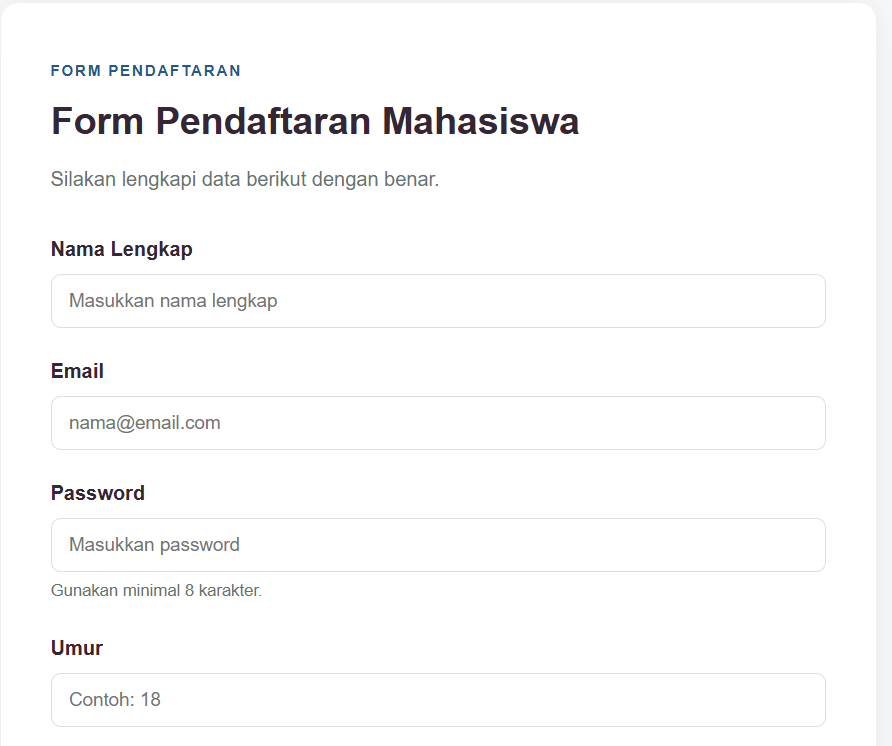

# Praktikum Desain Web — Form Pendaftaran Mahasiswa

Tugas Praktikum Desain Web Pertemuan 7 (**HTML Form Dasar: Input & Pengiriman Data**).

---

## Data Diri

| Informasi Praktikan | Keterangan |
| :--- | :--- |
| **Nama** | Nabil Nugraha |
| **NPM** | 4525210052 |
| **Kelas** | A |

---

## 1. Form sebagai Antarmuka Input

Form digunakan untuk menerima data dari pengguna yang nantinya dapat dikirim ke aplikasi. Pada proyek ini, seluruh elemen input ditempatkan dalam satu tag `<form>`.

```html
<form action="/proses-pendaftaran" method="post">
```

## 2. Action dan Method

| Atribut | Nilai | Penjelasan |
| :--- | :--- | :--- |
| `action` | `/proses-pendaftaran` | Menentukan tujuan pengiriman data. |
| `method` | `post` | Mengirim data melalui body HTTP request. |

Action masih menggunakan alamat sementara karena belum terhubung dengan backend. Penggunaan HTTPS dan validasi server tetap diperlukan untuk menjaga keamanan data.

## 3. Tipe Input yang Digunakan

Form ini menggunakan lima tipe input, satu elemen `select`, dan satu `textarea` untuk mengumpulkan data pendaftaran mahasiswa.

| No | Field | Tipe | `id` | `name` |
| :-: | :--- | :--- | :--- | :--- |
| 1 | Nama Lengkap | `text` | `nama` | `nama` |
| 2 | Email | `email` | `email` | `email` |
| 3 | Password | `password` | `password` | `password` |
| 4 | Umur | `number` | `umur` | `umur` |
| 5 | Tanggal Lahir | `date` | `tanggal-lahir` | `tanggal-lahir` |
| 6 | Program Studi | `select` | `program-studi` | `program-studi` |
| 7 | Alamat | `textarea` | `alamat` | `alamat` |

Beberapa atribut tambahan digunakan untuk membantu validasi, seperti `required` untuk data wajib diisi serta `min` dan `max` untuk membatasi umur. Setiap elemen juga memiliki atribut `name` sebagai identitas data saat dikirim ke server.

## 4. Label dan Aksesibilitas

Setiap kolom input menggunakan `<label>` yang dihubungkan dengan atribut `for` dan `id`.

```html
<label for="nama">Nama Lengkap</label>
<input type="text" id="nama" name="nama" required>
```

Penggunaan label memudahkan pengguna mengenali setiap kolom dan membantu aksesibilitas form. Dengan demikian, setiap input memiliki keterangan yang jelas.

## 5. Jenis Button

Form menggunakan tiga jenis button sesuai ketentuan tugas.

| Button | `type` | Fungsi |
| :--- | :--- | :--- |
| **Daftar** | `submit` | Mengirim data pendaftaran. |
| **Reset** | `reset` | Mengosongkan seluruh isian form. |
| **Kembali** | `button` | Tombol biasa yang tidak mengirim form. |

## 8. Hasil Tampilan

### Bagian atas form

Menampilkan header, Nama Lengkap, Email, Password, dan Umur.



### Bagian bawah form

Menampilkan Tanggal Lahir, Program Studi, Alamat, dan ketiga tombol.

.png)

---

## 9. Ringkasan Perubahan, Masalah, dan Solusi

Form pendaftaran mahasiswa dibuat menggunakan HTML Form dengan metode `post` dan action sebagai tujuan pengiriman data. Form terdiri dari lima tipe input, satu elemen select, satu textarea, serta tiga jenis button.

Setiap kolom dilengkapi label, `id`, dan `name` agar data dapat dikenali dengan baik. Atribut tambahan seperti `required`, `min`, dan `max` juga digunakan untuk membantu membatasi pengisian data.

Hasil akhirnya, form memiliki tampilan yang rapi dan struktur HTML yang sesuai dengan materi praktikum serta dapat dikembangkan untuk dihubungkan dengan backend.
